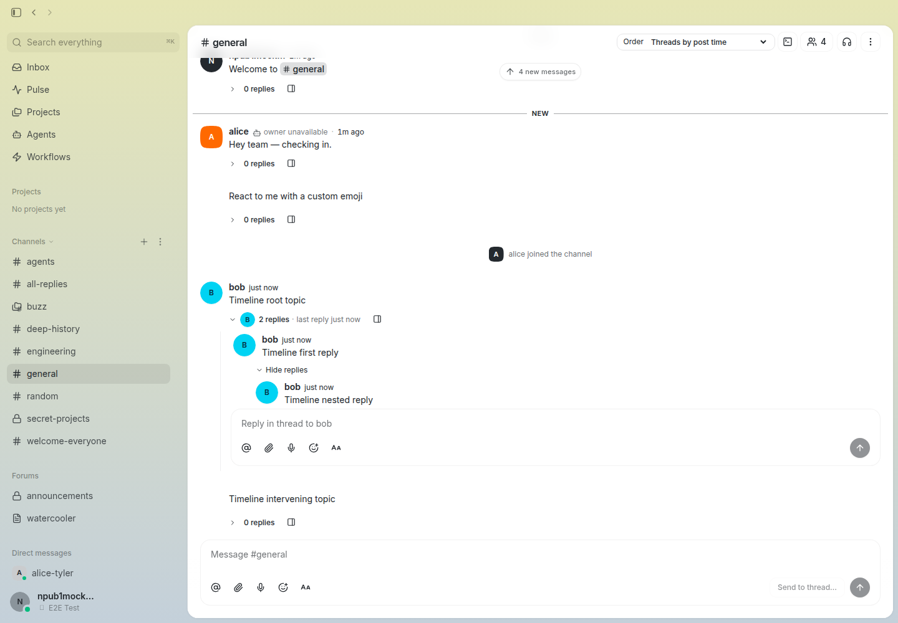
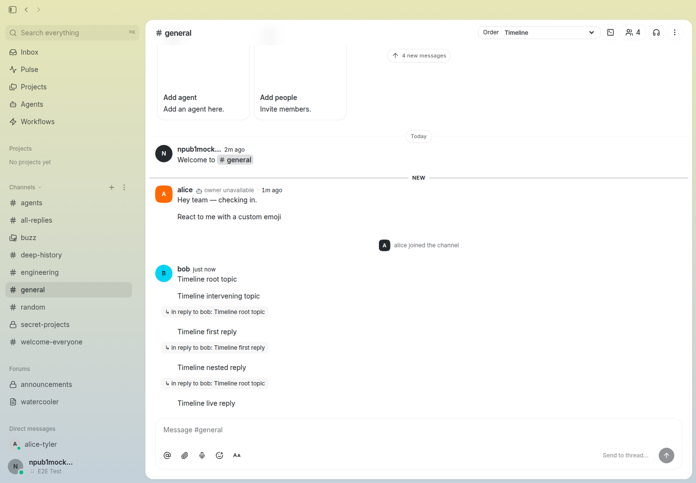

# Channel Order setting and Timeline view

The desktop channel header offers one **Order** setting:

1. **Threads by post time** — the existing default, available now.
2. **Threads by latest activity** — reserved and visibly disabled as coming soon.
3. **Timeline** — flat chronological conversation, available now.

This first increment ships modes 1 and 3 under Jacob's explicit fallback. It keeps
the original per-channel preference key/values, including any saved Timeline choice;
there is no second overlapping toggle. Activity ordering is not silently simulated.
The choice is local to this browser/device, relay and channel; no signed events,
thread relations or other participants' preferences change.

Timeline merges the loaded channel window with each summarized reply subtree.
It sorts by the original `created_at`, then event ID, and removes depth indentation
and collapsed thread summaries from this presentation. Parent/root references stay
intact. Each reply has a compact parent-author/body quote; clicking it scrolls
to the original in this view and highlights it. A parent that is not loaded gets
an honest unavailable label, and its quote opens the thread beside the Timeline.

Reply keeps the reader in Timeline: the quoted parent appears above the channel
composer, and sending publishes an ordinary signed reply with the same NIP-10
root/parent tags. The quote is a link back to the original. Cancel with its X or
Escape; the draft text stays. The target is saved with the channel draft, so
leaving and returning cannot turn a drafted reply into a top-level message, and
it stays visible if Order changes. A failed send restores it. Without a quoted
parent the composer posts top-level messages.

## Flat view for one thread

A thread with nested replies has its own Order choice, **Nested** (default) or
**Flat**, in the thread panel and its inline preview. Flat lists every loaded
reply oldest first, with a quoted parent on replies that answer another reply.
The choice is remembered on this device for that community, account, channel and
thread, and changes no signed data.

Mobile offers the same two choices: **Order** in channel details, and the
Nested/Flat control above a thread's replies. Swipe a message left, or use its
Reply action, to answer it in place.

Channel history keeps its existing pagination. Discovered reply roots share the
existing paginated thread query cache and loader, including its two-native-read
concurrency limit and page safety bound. Switching away cancels queued work through
query abort signals. Loading/refetching and failed subtree states remain visible;
Retry reloads failed subtrees while successful history stays usable.

Reactions, edits, deletion overlays, live subscriptions and send use the existing
message paths. Timeline rows and flat threads show replies the reader did not
open, so showing them never marks them read; the message menu's Mark read still
does. Organization annotations can change reply context presentation; the flat
comparator only reads original message timestamps and IDs.

## Acceptance

`desktop/tests/e2e/telegram-replies.spec.ts` covers in-place replies, cancel,
draft and target restore, exact signed tags, quote jumps, per-thread Flat and the
read rule.

`desktop/tests/e2e/channel-timeline.spec.ts` exercises the actual app with the
synthetic Tauri mock bridge: chronology, nested chips/ancestor expansion, live
replies, reaction toggling, top-level sending, in-place quote jumps, local preference persistence, 205 same-second replies across a page
boundary, bounded concurrency, loading and partial failure/retry.

Human acceptance before ready-for-review: open a busy channel, select Timeline,
scroll through older roots/replies, receive a new reply, react and post a top-level
message. Reply to a nested message and confirm the order stays Timeline, the quote
jumps to the original, and the reply appears nested in Threads. Switch channels
mid-reply, return, and confirm both text and quoted parent. Open one thread, choose
Flat, reload, and confirm only that thread is flat. Confirm unread markers stay
until Mark read.

Linux browser acceptance does not verify native macOS or iOS behavior.

## Latest-activity mode design (follow-up; not enabled)

The stable preference identity `activity` is reserved alongside `threads` and
`timeline`. Its ordering unit is the whole root plus its inline reply subtree.
The key is `max(root.created_at, latest_reply.created_at)`, then root ID for ties;
reply order inside the block remains original timestamp/ID. Signed organization
annotations never rewrite those clocks. Paginated summary/reply evidence can
advance the key without changing signed events, read state or identity.

Keep semantic order separate from displayed order while someone is reading. Save
the current message ID and pixel offset as the viewport anchor. Queue activity
moves while away from the bottom, retaining that displayed order and placing a
subtle **thread moved ↓** / **new activity** marker at the origin. Activating the
marker or returning to following newest applies the queued root-block moves and
restores the keyed anchor after measurement. At the bottom, following may apply
moves as one measured update; a short-lived origin marker explains the relocation.
Do not treat a moved block, a summary, or a history fetch as a seen reply body.

Before enabling mode 2, acceptance must cover live bumps above/below the viewport,
expanded root blocks, same-second ties, older-page merges, a selected reply inside
a moved block, focus/background changes, and PR31 body-only acknowledgement. This
requires scroll-manager integration rather than a simple sort replacement, so it
is deliberately outside the first stable Timeline increment.

## Desktop screenshots

Synthetic mock-bridge fixtures at 1440 × 1000:

| Threads by post time | Timeline |
| --- | --- |
|  |  |
